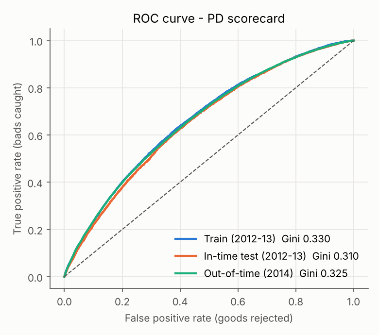
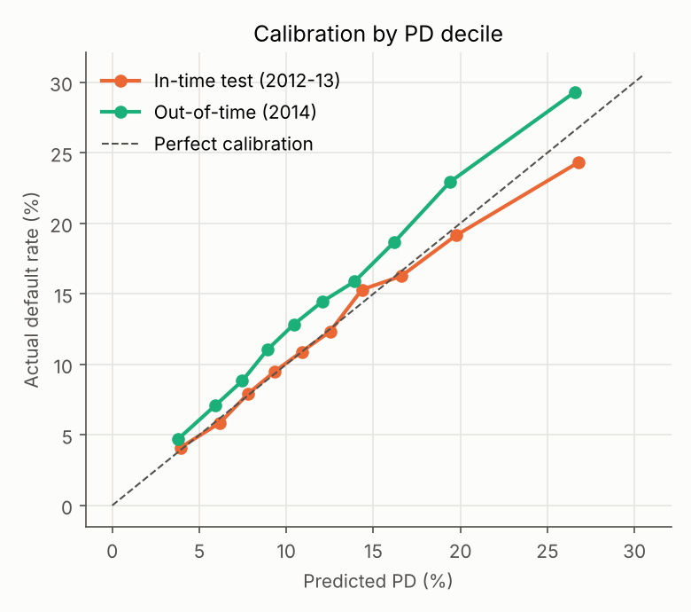
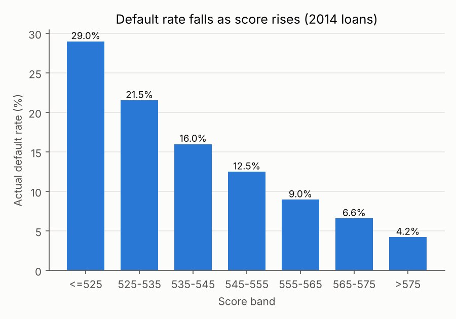
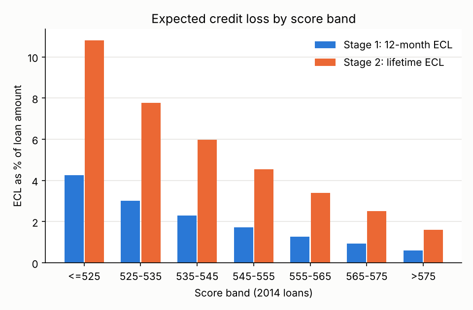

# Retail Credit Scorecard, IFRS 9 Expected Credit Loss & Basel IRB Capital

An end-to-end retail credit risk project on **real Lending Club loan data (326,192 loans, 2007–2014)**:

1. an application **PD scorecard** (WoE binning, Information Value, logistic regression, points scaling), fine-tuned
   with credit-bureau attributes,
2. **model validation** the way a bank's validation team does it: Gini, KS, calibration, Hosmer–Lemeshow, PSI,
   out-of-time testing, a benchmark against the lender's own grades, and a **LightGBM challenger**,
3. **LGD and EAD** estimated from historical defaults,
4. **IFRS 9 expected credit loss** (Stage 1 12-month and Stage 2 lifetime), back-tested against realised losses,
5. **Basel IRB capital** (other-retail risk-weight formula) and a **baseline vs adverse stress scenario**,
6. a **Streamlit app** that scores a new application and shows its PD, ECL and capital.

## Data

Lending Club's public issued-loan files (all loans issued 2007–2014), packaged per year in
[kuhnrl30/LendingClubData](https://github.com/kuhnrl30/LendingClubData). `src/get_data.py` downloads them (~60 MB).

| Step | Loans |
|---|---|
| All loans issued 2007–2014 | 466,345 |
| 36-month term only (every loan had matured by the 2017 snapshot, so the outcome is known) | 337,996 |
| Dropped: "does not meet credit policy" loans and unresolved loans (Current, Grace, Late 16–30 days) | |
| **Modelling population** | **326,192** |

**Default (bad)** = Charged Off, Default or Late 31–120 days. **Good** = Fully Paid.
Only information available on the application date is used as a model input. That includes the credit-bureau
attributes Lending Club pulled at application, such as card limits and accounts opened. Payment and recovery fields
are used only for LGD and EAD.

| Sample | Issue years | Loans | Default rate | Used for |
|---|---|---|---|---|
| Train (70% random) | 2012–2013 | 100,679 | 12.8% | building the scorecard |
| In-time test (30% random) | 2012–2013 | 43,213 | 12.6% | checking overfitting |
| **Out-of-time test** | **2014** | **153,204** | **14.6%** | final validation, ECL and capital |
| History | 2007–2011 | 29,096 | 11.1% | LGD, EAD, default timing, crisis stress factor |

The scorecard is built on 2012–13 because that is when Lending Club started recording the bureau attributes.

## Method and results

### 1. Scorecard (`src/woe.py`, `src/build_scorecard.py`)
- 35 candidate variables: 18 from the application and 17 credit-bureau attributes.
  - Numeric variables are fine-classed into quantile bins, then neighbouring bins are merged until the bad rate is
    **monotonic** and every bin holds ≥ 5% of the sample.
  - Missing values get their own bin.
- Information Value: kept variables with IV ≥ 0.01 and removed one of any pair with WoE correlation above 0.6.
  State of residence was deliberately left out: geography can act as a proxy for protected groups, which is a
  fair-lending risk.
- Logistic regression on WoE values (statsmodels). Every coefficient must have the expected sign and p < 0.05.
- **14 variables in the final model**, all significant at p < 0.001:
  - Annual income (IV 0.101).
  - Unused credit-card limit (0.088).
  - Total credit limit (0.069).
  - Loan-to-income (0.047).
  - Accounts opened in the last 24 months (0.045).
  - Debt-to-income (0.041).
  - Home ownership.
  - Months since the most recent account.
  - Enquiries in the last 6 months.
  - Revolving utilisation.
  - Purpose.
  - Revolving accounts with a balance.
  - Employment length.
  - Total accounts.
- Scaling: 600 points = 50:1 good:bad odds, 20 points to double the odds (PDO). The points table is in
  `results/scorecard.csv`.

### 2. Fine-tuning (`src/tuning_experiments.py` → `results/tuning_experiments.csv`)
Each experiment changes one thing. Every model is judged on the 2014 out-of-time Gini.

| Experiment | Variables | Gini, in-time test | **Gini, 2014** |
|---|---|---|---|
| First version: 2007–13 loans, application variables, IV ≥ 0.02 | 7 | 0.268 | 0.259 |
| + finer bins, IV ≥ 0.01, state | 10 | 0.277 | 0.268 |
| 2012–13 loans, application variables only | 7 | 0.257 | 0.260 |
| 2012–13 + credit-bureau variables | 13 | 0.306 | 0.318 |
| **2012–13 + bureau variables, IV ≥ 0.01 (chosen)** | **14** | **0.310** | **0.325** |
| + finer bins (2.5%) | 14 | 0.311 | 0.326 |
| + state | 15 | 0.313 | 0.327 |
| LightGBM challenger (same features) | – | 0.346 | 0.357 |

- **The bureau variables made the difference.** Gini rose from 0.259 to 0.325 (+25%). Finer bins and adding state
  barely helped, so I kept the simpler, fairer version.
- **Challenger gap.** The LightGBM model scores 0.03 Gini higher. It also overfits (Gini 0.62 on its training data
  against 0.36 out of time) and cannot be turned into a points table. The scorecard stays the champion and LightGBM
  remains a benchmark (`src/challenger.py`).

### 3. Validation (`src/validate.py`)

| | Train | In-time test | Out-of-time 2014 |
|---|---|---|---|
| Gini | 0.330 | 0.310 | **0.325** |
| KS | 0.239 | 0.227 | 0.232 |
| Brier score | 0.107 | 0.106 | 0.120 |
| Mean predicted PD vs actual default rate | 12.8% / 12.8% | 12.8% / 12.6% | 12.5% / **14.6%** |
| Lending Club sub-grade Gini (benchmark) | 0.278 | 0.268 | 0.319 |

- **Rank ordering holds out of time.** The 2014 default rate falls from **29.0%** in the lowest score band (≤ 525)
  to **4.2%** in the highest (> 575), a 6.9× spread.
- **Beats the lender's own grade.** The scorecard's 2014 Gini of 0.325 is higher than Lending Club's sub-grade
  (0.319), using only the public data.
- **Stable population.** Score PSI between train and 2014 is **0.003**.
- **Calibration drift.** 2014 loans defaulted more than predicted (14.6% vs 12.5%) while the population stayed the
  same. The vintage was riskier, not the borrowers. Re-estimating the intercept (+0.188 on log-odds) fixes it. This
  is the standard annual-review recalibration.

 


### 4. LGD, EAD and default timing (`src/ecl_capital.py`)
Estimated from the **9,130 loans charged off from the 2007–2012 vintages**, whose recoveries had finished:
- **LGD** = 1 − (recoveries − collection fees) / exposure at default = **90.8%**. These are unsecured loans, and
  little was recovered after charge-off. LGD is applied by grade.
- **EAD factor** (balance at default ÷ original amount): **0.89** for defaults in the first year and **0.59** over
  the loan's life, because the loans amortise.
- **Timing:** **22.6%** of lifetime defaults happen in the first 12 months, so 12-month PD = 0.226 × lifetime PD.
- **Crisis stress factor:** a logistic regression on 2007–13 loans, using borrower-risk variables plus a dummy for
  the 2007–08 vintages. With the same borrower quality, crisis-era loans had **1.37× the default odds**
  (95% CI 1.21–1.56).

### 5. IFRS 9 ECL and Basel capital on the 2014 book ($1.93 bn, 153,204 loans)

| Scenario | Stage 1 ECL (12-month) | Stage 2 ECL (lifetime) | Basel IRB capital | RWA density |
|---|---|---|---|---|
| Baseline, model PD | $37.6 M (1.95%) | $98.1 M (5.09%) | $180.8 M | 117% |
| Baseline, recalibrated PD | $44.0 M (2.28%) | $114.9 M (5.96%) | $187.2 M | 121% |
| **Adverse**: crisis PD odds × 1.37 and LGD +5 pp | **$60.0 M (3.11%)** | **$156.6 M (8.12%)** | **$207.5 M** | 134% |

- ECL = PD × LGD × EAD, discounted at each loan's interest rate. All loans are Stage 1 at origination. The Stage 2
  column shows the lifetime allowance the bank would hold after a significant increase in credit risk.
- **Back-test:** undiscounted lifetime loss with the recalibrated PD is $142.2 M against **$139.3 M actually lost**
  (102%). Without recalibration it is 87%.
- Capital uses the Basel IRB "other retail" formula (asset correlation 3–16%, 99.9% confidence) with the 12-month PD,
  floored at 0.05%.
- **Under stress,** ECL rises about 36% and capital about 11%. Capital already covers a 1-in-1000 outcome, so it
  moves less.



## Run it

```bash
pip install -r requirements.txt
./run_all.sh                          # download -> prepare -> scorecard -> validate -> challenger -> ECL & capital
python src/tuning_experiments.py      # optional: reproduce the fine-tuning table (about 10 minutes)
streamlit run app/app.py              # score a new application
```

## Limitations
- The public file has no FICO score and no monthly payment history, so IFRS 9 staging is shown as Stage 1 vs
  Stage 2 at origination, not tracked over time.
- Approved loans only (no reject inference).
- Long-run average LGD. Basel requires a downturn LGD, which the adverse scenario approximates.
- Discounting uses average default timing, not a full monthly cash-flow schedule.
- Learning project. Not an actual credit decision tool.
